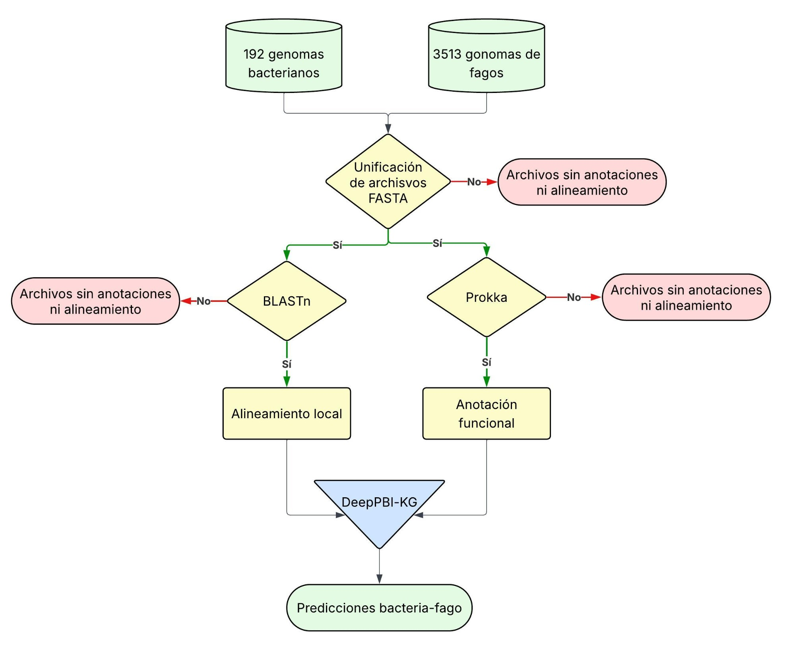
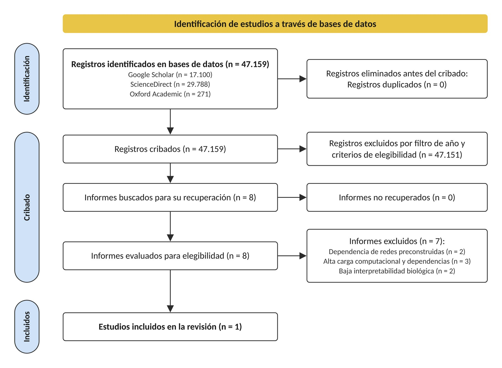

# 16S-FenrirPipeline

**Predicción de interacciones bacteria-fago en el rizobioma de la gulupa con DeepPBI-KG**

## Introducción

Esta rama del repositorio reúne la implementación de **DeepPBI-KG** ([Wei et al., 2024](https://github.com/Tongqing-Wei/DeepPBI-KG)) desarrollada para el trabajo de grado *Análisis del microbioma de Passiflora edulis f. edulis mediante secuenciación dirigida al gen 16S usando MinION y predicción de las posibles interacciones bacteria-fago*. DeepPBI-KG es un modelo de aprendizaje profundo que estima la probabilidad de que un fago interactúe con una bacteria a partir de sus genomas. Aquí se adaptó para recibir los perfiles taxonómicos que entrega el pipeline 16S de la rama `pipeline` y evaluar todas las combinaciones posibles entre las bacterias más abundantes y los 3513 fagos de referencia del modelo.

El objetivo es anticipar qué fagos podrían interactuar con las bacterias que componen el rizobioma de la gulupa, en particular con las más abundantes. Junto con la caracterización del rizobioma, ese conocimiento sirve de base para formular, en el futuro, bioproductos dirigidos a este cultivo.

El modelo, sus pesos y el panel de fagos de referencia pertenecen a sus autores. Los scripts de este trabajo son adaptaciones del código original o scripts propios.

## Ramas del repositorio

| Rama | Contenido |
|---|---|
| [`pipeline`](../../tree/pipeline) | Pipeline 16S ONT: basecalling, estadísticas, limpieza, taxonomía y diversidad (Objetivos 1 y 3). Solo descripción, sin código |
| `algoritmo` (Aquí) | Predicción de interacciones bacteria-fago con DeepPBI-KG (Objetivos 2 y 3). Solo descripción, sin código |
| [`anexos`](../../tree/anexos) | Anexos del documento: tablas de resultados, figuras, matrices de predicción y grafos |

La entrada del algoritmo es la tabla de abundancias relativas que produce el paso de taxonomía del pipeline. Por motivos de confidencialidad, los códigos y la totalidad de los datos utilizados no están abiertos al público. Esta rama conserva la descripción de cada paso, sin los scripts ni los comandos de ejecución. Los códigos y los datos pueden solicitarse al autor bajo acuerdo académico.

# Pasos del algoritmo

El algoritmo se aplicó a dos conjuntos de datos: las abundancias del BioProject PRJNA1020132, que sirvieron para validar la implementación (Objetivo 2, 192 genomas bacterianos y 674 496 pares evaluados), y las abundancias de las muestras de rizobioma de gulupa (Objetivo 3).

  

Los pasos se describen tal como se aplicaron a las muestras de gulupa con las abundancias del modelo de basecalling **HAC** (79 genomas bacterianos). Todo se ejecutó en Linux con entornos conda, en CPU.

| Paso | Herramienta principal |
|---|---|
| [1. Selección y descarga de genomas](#1-selección-y-descarga-de-genomas) | NCBI Datasets |
| [2. Anotación y alineamiento](#2-anotación-y-alineamiento) | Prokka y BLASTn |
| [3. Predicción con DeepPBI-KG](#3-predicción-con-deeppbi-kg) | DeepPBI-KG |
| [4. Filtrado de interacciones](#4-filtrado-de-interacciones) | Código propio |
| [5. Redes de interacción](#5-redes-de-interacción) | Gephi |

<b>Revisión bibliográfica para escoger el algoritmo</b>

 

DeepPBI-KG se escogió tras una búsqueda en Google Scholar, ScienceDirect y Oxford Academic (2020 en adelante). De ella salieron 8 herramientas con software publicado y repositorio de acceso libre (PTBGRP, CoMPHI, PB-LKS, PHISDetector, DeepPBI-KG, GSPHI, iPHoP y PBIP), que se compararon por reproducibilidad, costo computacional e interpretabilidad biológica. Las demás se descartaron por depender de redes preconstruidas, por su carga computacional y de dependencias, o por funcionar como cajas negras.

  
   Diagrama de flujo PRISMA para la búsqueda y selección del algoritmo predictivo (Figura 22 de la tesis)

---

## 1. Selección y descarga de genomas

### Para qué sirve

DeepPBI-KG trabaja con genomas completos, no con lecturas del gen 16S. Este paso traduce el perfil taxonómico en un conjunto de genomas: toma los taxones con abundancia relativa promedio de al menos 0,1 % y descarga de NCBI un genoma de referencia para cada uno. El resultado es un archivo FASTA por taxón, que representa a esa bacteria en la predicción.

### Herramientas

**NCBI Datasets** (`datasets`) es la herramienta de línea de comandos de NCBI para descargar ensamblajes genómicos. Acepta un TaxID o un nombre científico, y permite filtrar por nivel de ensamblaje (completo, cromosoma, scaffold) y pedir solo el genoma de referencia de un taxón.

### Cómo se construyó el script

Un script propio lee la tabla de abundancias relativas de EMU, selecciona los taxones que superan el umbral de abundancia promedio y busca en NCBI un genoma para cada uno: primero a nivel de especie y, si no lo hay, con un representante del género. En todos los casos da prioridad a los ensamblajes más completos.

---

## 2. Anotación y alineamiento

### Para qué sirve

DeepPBI-KG no lee secuencias crudas: calcula sus características a partir de los genes de cada genoma. Este paso anota los genes codificantes (CDS) de cada fago y de cada bacteria, y alinea cada genoma contra una base de referencia para encontrar el más parecido. El modelo no usa ese alineamiento para predecir, pero su reporte lo incluye para relacionar cada genoma con interacciones ya descritas en los datos de entrenamiento. El resultado es una carpeta de anotación por genoma, con su archivo GenBank, y un archivo de alineamiento por genoma.

### Herramientas

- **Prokka** anota genomas procariotas y virales: predice los genes codificantes con Prodigal y asigna a cada uno un producto por homología contra bases de proteínas. Entrega, entre otros, un archivo GenBank con la secuencia y la anotación de cada CDS, que es lo que lee DeepPBI-KG.
- **BLASTn** alinea una secuencia de nucleótidos contra una base de datos y reporta los aciertos ordenados por similitud. Aquí se conserva solo el mejor acierto de cada genoma.

### Cómo se construyó el script

Se partió del script de anotación y alineamiento que trae DeepPBI-KG y se adaptó a los formatos y rutas de este trabajo, además de aprovechar mejor los núcleos disponibles. Un script auxiliar permite anotar por lotes y retomar el trabajo si se interrumpe, lo que hace falta con un panel de 3513 fagos.

---

## 3. Predicción con DeepPBI-KG

### Para qué sirve

Estima, para cada par fago-bacteria, la probabilidad de que interactúen. Como no se sabe de antemano qué fagos podrían atacar a las bacterias del rizobioma, se evalúan todas las combinaciones entre los 3513 fagos de referencia y las bacterias del paso 1. El resultado es una tabla con dos probabilidades por par y un reporte HTML.

### Herramientas

**DeepPBI-KG** describe cada genoma con características calculadas a partir de sus CDS:

- **De ADN:** frecuencia de cada nucleótido, contenido GC, frecuencia de cada codón y su uso relativo entre codones sinónimos.
- **De proteína:** propiedades fisicoquímicas (peso molecular, punto isoeléctrico, inestabilidad, fracciones de estructura secundaria), composición de aminoácidos y los descriptores CTD y Z-scale.

Cada CDS queda descrito por 223 características (133 de ADN y 90 de proteína), que se resumen sobre todos los genes del genoma con seis estadísticos (media, máximo, mínimo, desviación estándar, mediana y varianza). Así, cada genoma queda representado por 6 × 223 = 1338 valores, sin importar su longitud. Para cada par se unen los vectores del fago y de la bacteria (2676 valores), se estandarizan con el escalador del modelo y entran a una red neuronal profunda con cinco capas ocultas y una neurona de salida sigmoide, cuyo resultado es una probabilidad entre 0 y 1.

El modelo tiene dos versiones con la misma arquitectura y pesos distintos:

- **Genes clave** (`key_gene_output`): usa solo los CDS de una lista de genes que los autores seleccionaron con Random Forest como determinantes de la interacción; estima el potencial de infección.
- **Genoma completo** (`wgs_output`): usa todos los CDS; estima la compatibilidad a nivel de genoma.

### Cómo se construyó el script

El script conserva el cálculo de características, la arquitectura y los pesos del original. Lo que cambia es la forma de ejecutarlo, para que pueda evaluar cientos de miles de pares en CPU: el cálculo de características se paraleliza, los resultados intermedios se reutilizan y la predicción se hace por lotes.

---

## 4. Filtrado de interacciones

### Para qué sirve

La predicción asigna una probabilidad a cada uno de los cientos de miles de pares evaluados, y la mayoría no corresponde a interacciones plausibles. Este paso conserva solo las interacciones con alta probabilidad, usando un umbral de 0,85. El resultado son tres tablas de interacciones listas para importar en Gephi.

### Herramientas

El filtrado se hace con código propio en pandas. Se aplica el umbral a cada salida del modelo por separado y a la **probabilidad compuesta**, el promedio de ambas. La compuesta es la que se usa para las redes, porque exige que el par sea favorable tanto a nivel de genes clave como de genoma completo: una sola salida alta no alcanza si la otra es baja.

### Cómo se construyó el script

Un script propio aplica el umbral a cada salida del modelo y a la probabilidad compuesta, y deja las interacciones resultantes como tablas de aristas que Gephi importa directamente.

---

## 5. Redes de interacción

### Para qué sirve

Representa las interacciones filtradas como una red en la que los nodos son fagos y bacterias, y cada arista es una interacción predicha. La red muestra qué bacterias concentran más interacciones y qué fagos podrían infectar a varias bacterias. Se construyó la red completa y una reducida a los cuatro taxones más abundantes del rizobioma (*Lactococcus lactis*, *Weissella soli*, *Weissella oryzae* y *Lactobacillus coryniformis*), cuyas interacciones con mayor puntaje se contrastan con la literatura (Anexos 13 y 21) y se clasifican como evidencia directa, evidencia por cercanía taxonómica o sin evidencia. El resultado son los grafos de Gephi de ambas redes.

### Herramientas

- **Gephi** visualiza y analiza grafos. Las redes se dibujaron con una distribución dirigida por fuerzas, en la que los nodos conectados se atraen y los demás se repelen, de modo que los grupos de fagos que comparten bacterias quedan juntos. El tamaño de cada nodo es proporcional a su grado, es decir, a su número de interacciones.

### Cómo se construyó el script

Scripts propios asignan nombres legibles a los fagos y a las bacterias y reducen la tabla de aristas a los taxones de interés. Tanto la red completa como la reducida se importan en Gephi como tablas de aristas.

---

Johann Sebastian Gallego Sierra · Universidad El Bosque

