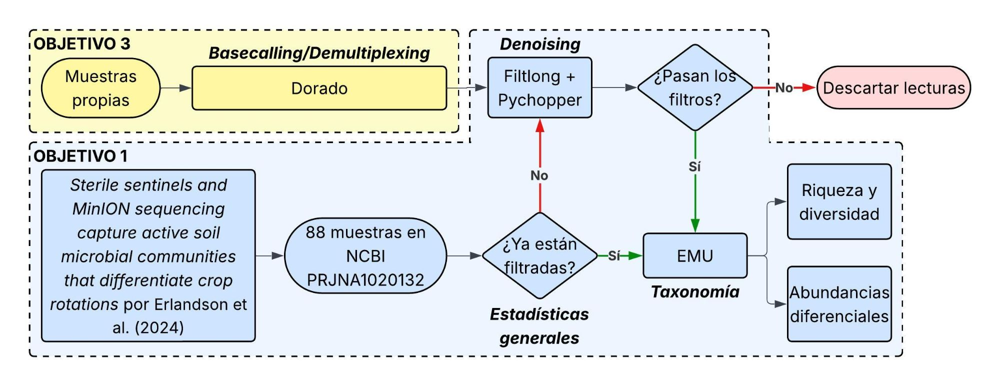
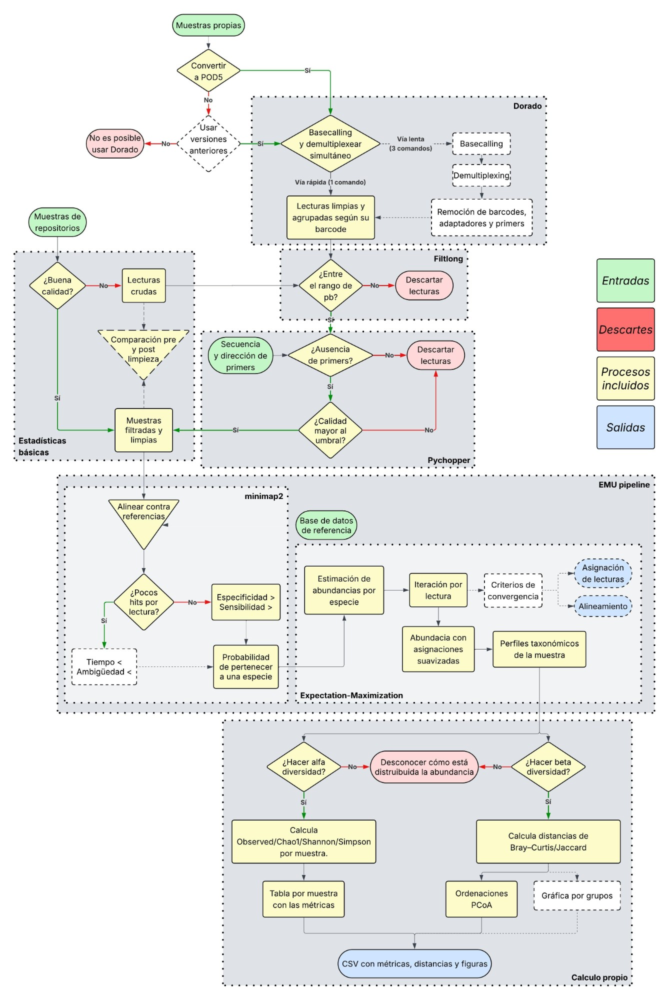
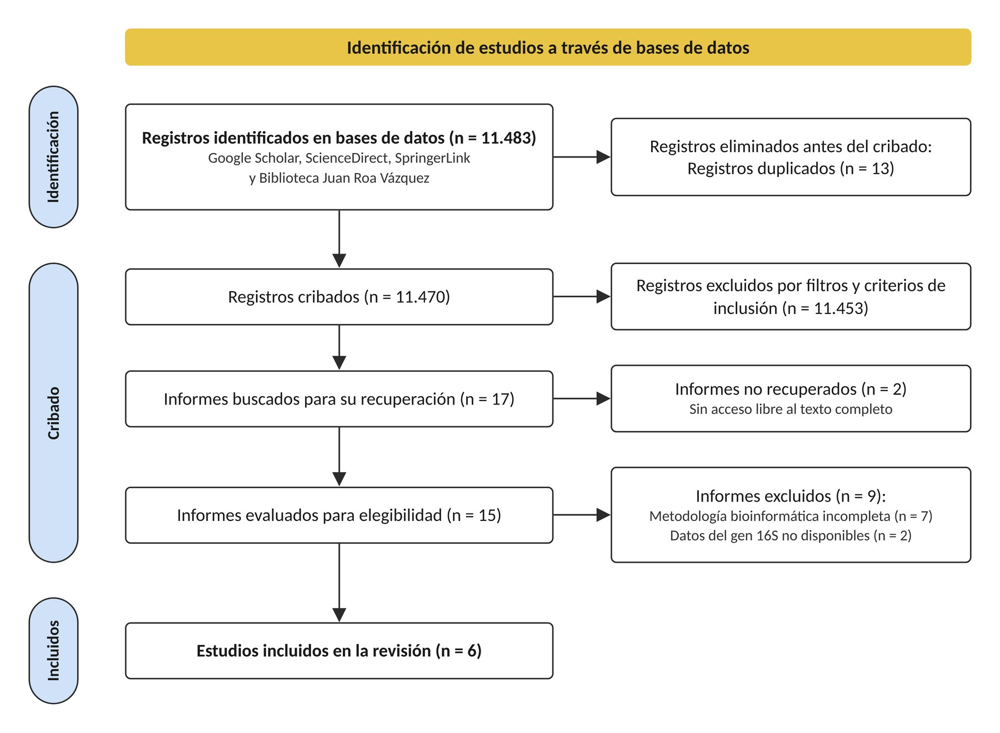
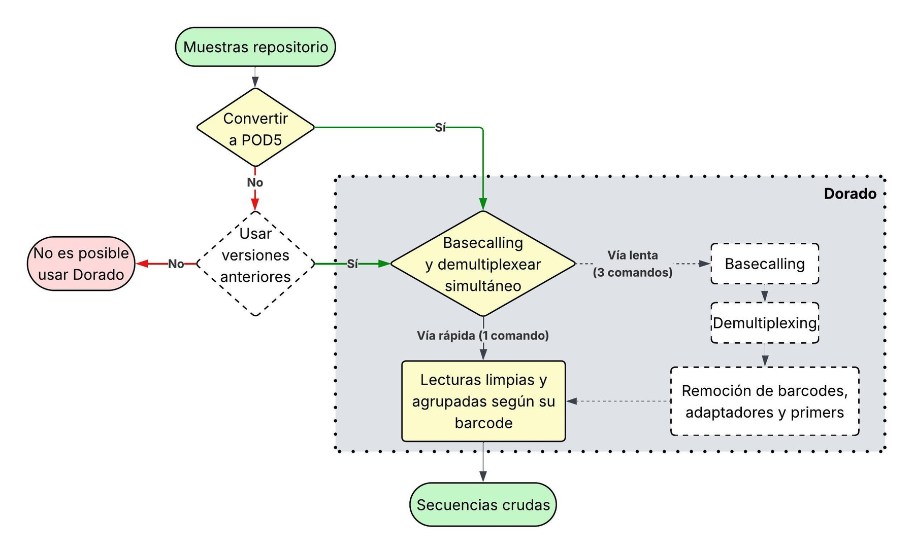
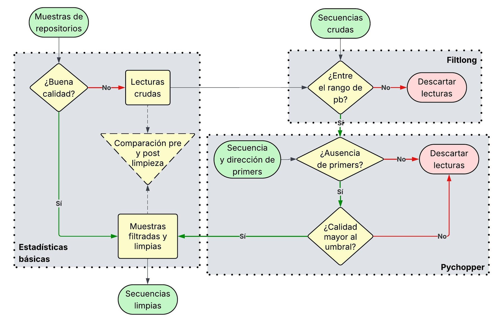
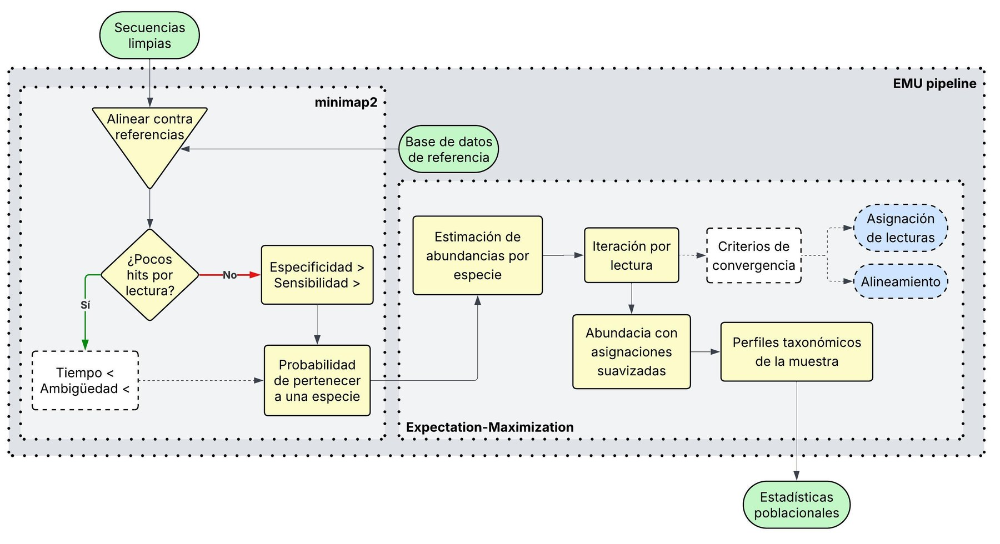
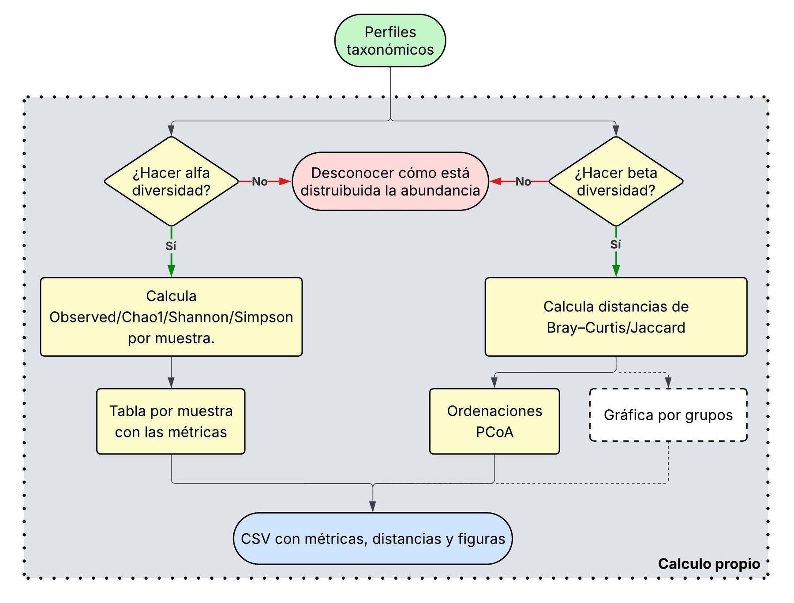

# 16S-FenrirPipeline

**Rizobioma de la gulupa con secuenciación 16S en Oxford Nanopore y predicción de interacciones bacteria-fago**

## Introducción

Este repositorio reúne las herramientas bioinformáticas desarrolladas e implementadas para el trabajo de grado *Análisis del microbioma de Passiflora edulis f. edulis mediante secuenciación dirigida al gen 16S usando MinION, y predicción de las posibles interacciones bacteria-fago* (Johann Sebastian Gallego Sierra, Universidad El Bosque). Son dos:

- **Un pipeline propio** para procesar lecturas del gen 16S rRNA completo obtenidas con MinION, desde la señal cruda hasta la diversidad microbiana.
- **La implementación de DeepPBI-KG** ([Wei et al., 2024](https://github.com/Tongqing-Wei/DeepPBI-KG)), un modelo de aprendizaje profundo que predice interacciones entre fagos y bacterias, adaptado para recibir los perfiles taxonómicos que entrega el pipeline.

Ambas herramientas responden a una misma necesidad: conocer el rizobioma de la gulupa, es decir, qué bacterias lo componen y cómo cambia entre sistemas de manejo agrícola, y anticipar qué fagos podrían interactuar con esas bacterias. Ese conocimiento sirve de cimiento para formular, en el futuro, bioproductos dirigidos a este cultivo.

## Ramas del repositorio

| Rama | Contenido |
|---|---|
| `pipeline` (Aquí) | Pipeline 16S ONT: basecalling, estadísticas, limpieza, taxonomía y diversidad (Objetivos 1 y 3). Solo descripción, sin código |
| [`algoritmo`](../../tree/algoritmo) | Predicción de interacciones bacteria-fago con DeepPBI-KG (Objetivos 2 y 3). Solo descripción, sin código |
| [`anexos`](../../tree/anexos) | Anexos del documento: tablas de resultados, figuras, matrices de predicción y grafos |

Por motivos de confidencialidad, los códigos y la totalidad de los datos utilizados no están abiertos al público. Esta rama conserva la descripción de cada paso, sin los scripts ni los comandos de ejecución. Los códigos y los datos pueden solicitarse al autor bajo acuerdo académico.

# Pasos del pipeline

El pipeline se aplicó a dos conjuntos de datos: las 88 muestras públicas del BioProject PRJNA1020132 (Erlandson et al., 2024), que sirvieron para validarlo (Objetivo 1), y las muestras propias de rizobioma de gulupa (Objetivo 3).

  

Los pasos se describen tal como se aplicaron a las muestras de gulupa con el modelo de basecalling **HAC**. Todo se ejecutó en Linux con entornos conda.

| Paso | Herramienta principal |
|---|---|
| [1. Basecalling y demultiplexing](#1-basecalling-y-demultiplexing) | Dorado |
| [2. Reporte de estadísticas básicas](#2-reporte-de-estadísticas-básicas) | Código propio, pycoQC y NanoPlot |
| [3. Limpieza: denoising y trimming](#3-limpieza-denoising-y-trimming) | Pychopper y Filtlong |
| [4. Taxonomía](#4-taxonomía) | EMU |
| [5. Diversidad](#5-diversidad) | scikit-bio y SciPy |

La comparación del pipeline con el artículo guía (Objetivo 1) se describe al final, en [Validación con el artículo guía](#validación-con-el-artículo-guía).

<b>Diagrama detallado del pipeline</b>

 

  

<b>Revisión bibliográfica para escoger las herramientas</b>

 

Las herramientas de cada paso se escogieron a partir de una búsqueda en Google Scholar, ScienceDirect, SpringerLink y la Biblioteca Juan Roa Vázquez con la ecuación `bioinformatics AND 16S oxford nanopore AND (soils OR passiflora)`. Solo seis estudios tenían una metodología bioinformática completa y las lecturas 16S disponibles en un repositorio; sus herramientas se resumen en el Anexo 1, y uno de ellos, Erlandson et al. (2024), es el artículo guía con el que se validó el pipeline.

  
   Diagrama de flujo PRISMA de la búsqueda bibliográfica (Figura 7 de la tesis)

---

## 1. Basecalling y demultiplexing

### Para qué sirve

El MinION no entrega secuencias: registra cambios de corriente eléctrica a medida que cada molécula de ADN atraviesa un poro. El basecalling traduce esa señal (archivos `POD5`) en lecturas de ADN, y el demultiplexing separa las lecturas según el barcode de cada muestra, porque todas se secuenciaron juntas en una misma celda. El resultado es un archivo BAM de lecturas por muestra, que es la entrada de los pasos siguientes.

### Herramientas

**Dorado** es el basecaller oficial de Oxford Nanopore, sucesor de Guppy. Usa redes neuronales entrenadas para convertir la señal de corriente en bases y ofrece tres modelos que intercambian velocidad por exactitud: `fast`, `hac` (*high accuracy*) y `sup` (*super accuracy*). Para el demultiplexing, busca en los extremos de cada lectura las secuencias de barcode del kit indicado y anota a qué muestra pertenece.

  
   Diagrama de caja para basecalling (Figura 2 de la tesis)

### Cómo se construyó el script

El basecalling se ejecuta directamente con Dorado, sin un script propio. Siguiendo la recomendación del fabricante, el basecalling y el demultiplexing se hacen en una sola ejecución.

Para escoger el modelo, la corrida se procesó con FAST, HAC y SUP y se compararon las lecturas aprobadas y el QScore de cada uno (Anexo 15). HAC y SUP fueron los modelos que se usaron en los pasos siguientes.

---

## 2. Reporte de estadísticas básicas

### Para qué sirve

Antes de limpiar hay que saber en qué estado llegan las lecturas: cuántas son, qué longitud y calidad tienen, y si conservan los primers. Estas métricas permiten decidir si una muestra necesita limpieza, justificar los parámetros de filtrado y, al repetir el cálculo después de limpiar, medir cuánto se removió. El resultado es una tabla con una fila por muestra.

### Herramientas

Las métricas se calculan con código propio, sin herramientas bioinformáticas externas. Como complemento visual se generaron reportes con **pycoQC**, que resume la corrida a partir de `sequencing_summary.txt` (rendimiento en el tiempo, calidad y longitud por barcode), y con **NanoPlot**, que grafica la distribución de longitud y calidad de los FASTQ limpios. Sus reportes corresponden a los Anexos 16 y 17 de la tesis. El diagrama de caja de este paso se comparte con la limpieza y se muestra en el [paso 3](#3-limpieza-denoising-y-trimming).

### Cómo se construyó el script

Un script propio en Python recorre los FASTQ de cada muestra y resume sus métricas básicas: número de lecturas, bases, longitudes, N50, contenido GC y QScore. De forma opcional estima qué proporción de las lecturas conserva los primers. La tabla se entrega como texto y como hoja de cálculo.

---

## 3. Limpieza: denoising y trimming

### Para qué sirve

Deja pasar a la clasificación taxonómica solo lecturas confiables del gen 16S. Descarta lecturas de baja calidad, incompletas o con una longitud que no corresponde al gen completo, recorta los primers y orienta todas las lecturas en el mismo sentido. El resultado es un FASTQ limpio por muestra y una tabla con cuántas lecturas y bases se conservaron en cada filtro.

### Herramientas

- **samtools** convierte el BAM de Dorado a FASTQ.
- **Pychopper** (Oxford Nanopore) busca los primers en los extremos de cada lectura alineándolos con `edlib`, que mide la distancia de edición, o con perfiles HMM. Con las combinaciones de primers válidas que se le indican, decide en qué hebra está la lectura, la invierte si viene en sentido reverso, recorta lo que queda entre los primers y rescata los segmentos útiles de lecturas fusionadas. También descarta lecturas por calidad media (`-Q`) y longitud mínima (`-z`).
- **Filtlong** evalúa cada lectura por longitud y calidad media. Aquí se usa solo con umbrales fijos, para quedarse con el rango de longitud del gen 16S completo, cosa que Pychopper no hace porque solo fija un mínimo.

  
   Diagrama de caja para reporte de estadísticas y limpieza (Figura 3 de la tesis)

El diagrama muestra cada filtro por separado. En el pipeline el orden es Pychopper primero y Filtlong después: Pychopper orienta y recorta las lecturas, y Filtlong aplica al final el rango de longitud del gen 16S completo.

### Cómo se construyó el script

Un script propio encadena, para cada muestra, la conversión del BAM a FASTQ, Pychopper y Filtlong, y mide las lecturas antes y después de cada filtro. Con esas mediciones arma un resumen de la remoción por muestra.

---

## 4. Taxonomía

### Para qué sirve

Identifica qué bacterias hay en cada muestra y en qué proporción. Como las lecturas cubren el gen 16S completo, se pueden clasificar directamente contra una base de referencia a nivel de especie, sin agruparlas antes en OTU o ASV. El resultado son tablas de abundancia relativa y de conteos por taxón y muestra, y curvas de rarefacción que indican si la profundidad de secuenciación alcanzó para capturar la riqueza.

### Herramientas

**EMU** alinea cada lectura contra una base de secuencias 16S con **minimap2**, guardando varios alineamientos posibles por lectura. Luego aplica un algoritmo de **esperanza-maximización (EM)**: estima de forma iterativa la abundancia de cada especie y la probabilidad de que cada lectura venga de cada una, hasta que el perfil converge. Así reparte las lecturas que alinean igual de bien con especies muy parecidas, en vez de asignarlas al azar. Se usó la base por defecto de EMU, que combina rrnDB v5.6 y NCBI 16S RefSeq.

  
   Diagrama de caja para clasificación taxonómica (Figura 4 de la tesis)

### Cómo se construyó el script

La etapa se reparte en varios scripts propios que se ejecutan en orden. El primero corre EMU por muestra, dejando por fuera las que tienen muy pocas lecturas, y une los resultados en tablas de abundancia y de taxonomía. Los siguientes reconstruyen los conteos por taxón a partir de las abundancias, agrupan las muestras por sistema agrícola y calculan las curvas de rarefacción por submuestreo repetido.

Para la validación del Objetivo 1, otro script compara las abundancias relativas medias por familia, género y especie con las del artículo guía mediante la correlación de Pearson (Anexos 7 a 9).

---

## 5. Diversidad

### Para qué sirve

Responde la pregunta central del proyecto: si la comunidad bacteriana del rizobioma difiere entre los sistemas de manejo Empresarial, Campesino y Agroecológico. La diversidad alfa describe cada muestra por dentro (cuántas especies tiene y qué tan repartidas están), la diversidad beta mide qué tan distintas son las muestras entre sí, y las pruebas estadísticas indican si esas diferencias son reales o producto del muestreo.

### Herramientas

Los cálculos se hacen con **scikit-bio** y **SciPy**:

- **Índice de Shannon** (−Σ pᵢ log pᵢ): combina cuántas especies hay y qué tan pareja es su abundancia; aumenta con la riqueza y con la equidad. Junto con la **riqueza observada** (número de especies presentes) describe la diversidad alfa.
- **Prueba de suma de rangos de Wilcoxon (Mann-Whitney U)**: compara los índices alfa entre cada par de sistemas sin suponer normalidad.
- **Bray-Curtis**: disimilitud cuantitativa, sensible a cambios de abundancia. **Jaccard**: disimilitud cualitativa, basada solo en presencia o ausencia.
- **PCoA** (Análisis de Coordenadas Principales): proyecta la matriz de Bray-Curtis en dos ejes para ver si las muestras de cada sistema se agrupan.
- **PERMANOVA**: prueba, con 999 permutaciones de las etiquetas de grupo, si los centroides de los sistemas difieren en ese espacio de distancias (estadístico pseudo-F y valor p).

  
   Diagrama de caja para estadísticas poblacionales (Figura 5 de la tesis)

El diagrama muestra los índices alfa que se consideraron al diseñar el paso (Observed, Chao1, Shannon y Simpson). En los resultados se usaron la riqueza observada y Shannon.

### Cómo se construyó el script

Un script propio toma la tabla de abundancias relativas de EMU, asigna cada muestra a su sistema de manejo y calcula los índices de diversidad alfa con sus pruebas entre pares de sistemas, las matrices de disimilitud, el PCoA y la PERMANOVA. La semilla de las permutaciones es fija, para que el resultado sea reproducible. Cada resultado se guarda como tabla y como figura.

---

## Validación con el artículo guía

### Para qué sirve

Comprueba, paso a paso, que el pipeline reproduce los resultados de Erlandson et al. (2024) sobre las mismas muestras del BioProject PRJNA1020132 (Objetivo 1). El artículo no publicó estadísticas por etapa para 2020, solo totales, así que la comparación se hace muestra por muestra: si una muestra tiene más lecturas, otra composición o más diversidad en el artículo, debería tenerla también en este trabajo. Complementa la correlación de Pearson de los Anexos 7 a 9; los resultados están en el Anexo 11.

### Herramientas

Del artículo se usan los archivos de su repositorio ([serlandson/sterile_sentinels](https://github.com/serlandson/sterile_sentinels)): las salidas de EMU por barcode, su tabla de conteos final, los datos de cada muestra y sus resultados de PERMANOVA. Las comparaciones son:

- **Correlación de Pearson** entre las lecturas por muestra en cada etapa y las lecturas asignadas por EMU en el artículo, y entre los índices de Shannon y la riqueza observada de cada muestra.
- **Bray-Curtis** entre el perfil de una muestra en este trabajo y el de la misma muestra en el artículo, frente al de muestras distintas, y **correlación de Pearson** entre esos dos perfiles.
- **Especies compartidas** por muestra, junto con la fracción de las lecturas de cada análisis que cae en ellas.
- **Prueba de Mantel** (scikit-bio) entre las matrices de distancia de los dos análisis, con distancia de Aitchison (CLR y euclidiana) y con Bray-Curtis.
- **PERMANOVA** por tipo de muestra (suelo y bolsa) y semana, con el mismo método del artículo: transformación CLR con pseudoconteo de 1 y distancia euclidiana.

### Cómo se construyó el script

Un script propio empareja cada muestra del BioProject con su equivalente en el artículo y compara, paso a paso, las lecturas, la composición, la diversidad alfa y beta y la PERMANOVA de ambos análisis. Entrega una figura con un panel por paso y las tablas de resumen (Anexo 11).

---

Johann Sebastian Gallego Sierra · Universidad El Bosque

